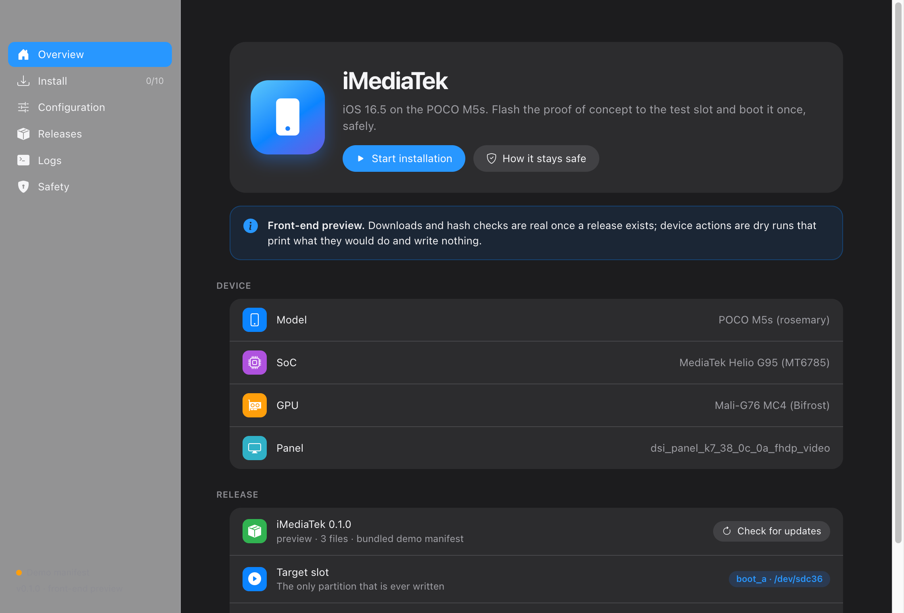
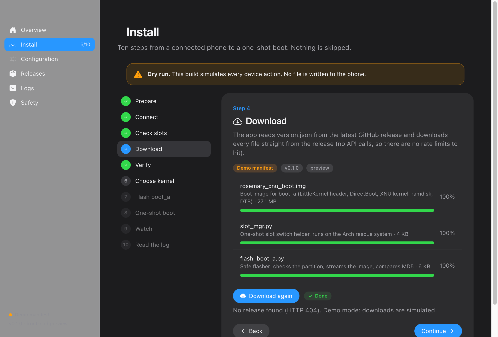
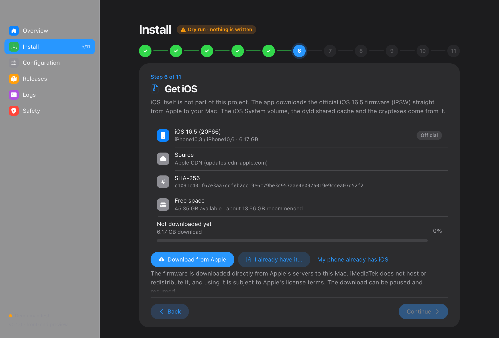
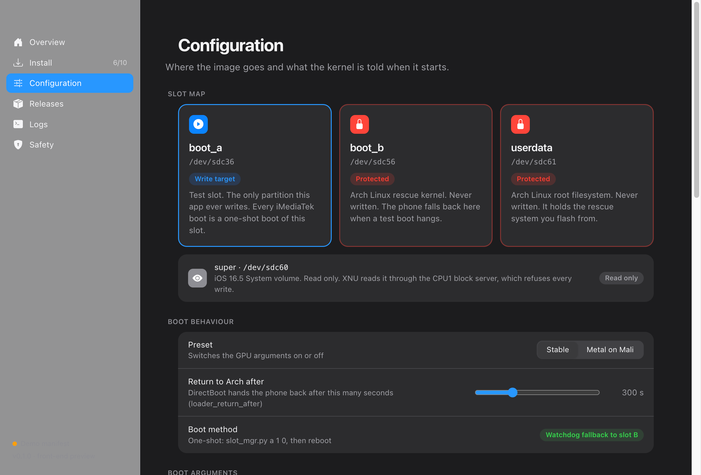
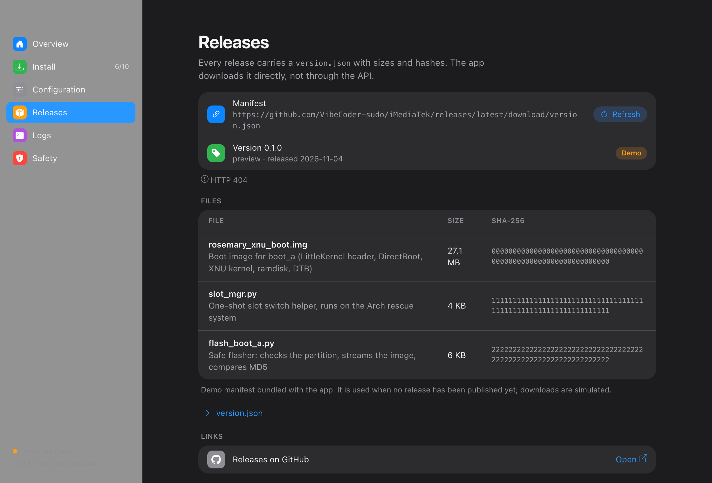

# iMediaTek

**iOS 16.5 (XNU `xnu-8796.121.2`) on the POCO M5s, a MediaTek Helio G95 phone.**
This repository holds the installer: a small Electron app that walks you through flashing the proof of concept to the test slot and booting it once, without touching the Linux rescue system.

> **Status: v0.2.0, early.** The interface, the release feed, downloading and hash checking work, and there is a **live device backend** (serial console to the phone's Arch system, partition checks, streamed write to `boot_a`, MD5 read-back, one-shot boot, log collection). It is tested against an emulated console, **not yet against a real phone**: do the first live run with Dry run off only up to *Check slots*, which is read only. The *Dry run* mode (default) still simulates every device action.



## What is in the proof of concept

The phone boots Apple's open-source XNU kernel, built from source, through LittleKernel and a small AArch64 shim called DirectBoot:

```
LittleKernel (stock)  ->  DirectBoot  ->  XNU 8796  ->  init  ->  Apple launchd  ->  backboardd / SpringBoard
```

Verified on hardware: LK to XNU with 1008 MB of RAM, the iOS 16.5 `System` volume mounted from flash as root, Apple's `launchd`, working touch, a Mali-G76 driver that draws through Metal (AIR to NIR to Panfrost). SpringBoard on the GPU is still being brought up. See [docs/FLASHING.md](docs/FLASHING.md) for what a healthy boot looks like.

**This repository and its releases contain no Apple software.** A release holds a boot-image *skeleton* (DirectBoot + XNU, empty root-image slot) and an image builder; the finished image is assembled on your computer. The iOS firmware (IPSW) is downloaded by the app straight from Apple's servers to your Mac; iMediaTek never hosts or redistributes it, and using it is subject to Apple's license terms.

## Safety model

| Partition | Device | Role | Touched by this app |
| --- | --- | --- | --- |
| `boot_a` | `/dev/sdc36` | Test slot | **Written** (the only partition a test boot writes) |
| `boot_b` | `/dev/sdc56` | Arch Linux rescue kernel | Never |
| `userdata` | `/dev/sdc61` | Arch Linux root filesystem | Never |
| `super` | `/dev/sdc60` | iOS System volume | Read only during test boots. The one-time iOS volume setup from the IPSW is planned, not in this preview, and will ask for its own confirmation |

- Every boot is **one-shot**: `slot_mgr.py a 1 0` arms slot A once, so a hang makes the hardware watchdog fall back to slot B (Arch).
- The partition label of `/dev/sdc36` is read back before every write.
- Every downloaded file is checked against its SHA-256; the boot image is also checked with MD5 after flashing.

## The installer

Twelve steps, nothing skipped:

1. **Prepare**: unlocked bootloader, Arch rescue on `boot_b`/`userdata`, battery, cable, how to leave a stuck boot.
2. **Connect**: open the Arch console over USB (`/dev/cu.usbmodemnyam00011`).
3. **Check slots**: read the partition table, refuse to go on if `sdc36` is not `boot_a`.
4. **Download**: read `version.json` from the latest release and download every file.
5. **Verify**: SHA-256 per file (MD5 for the boot image).
6. **Get iOS**: download the official iOS 16.5 (20F66) IPSW straight from Apple's CDN (6.17 GB), with pause/resume, a free-space check and a SHA-256 check. You can also point the app at an IPSW you already have, or skip the step if the phone already has iOS.
7. **Build image**: your computer builds `rosemary_xnu_boot.img` from the release's open parts and your IPSW (needs Python 3 and 7-Zip 23+). The few Apple files the root image needs (dyld, launchd job definitions) are read out of your IPSW and never leave your computer; the release contains none.
8. **Choose kernel**: Stable (CPU rendering) or Metal on Mali (experimental GPU path).
9. **Flash `boot_a`**: stream the image to `/dev/sdc36` and compare MD5.
10. **One-shot boot**: `slot_mgr.py a 1 0 && reboot -f`.
11. **Watch**: what you should see and when; how to leave early.
12. **Read the log**: mount pstore and read `console-ramoops-0`.

| | |
| --- | --- |
|  |  |
|  |  |

The **Configuration** page shows the slot map and every boot argument (required ones are locked), with presets and the resulting command line.

## Live mode

The *Dry run / Live* switch in the Install header decides whether device steps are simulated or real. In Live mode:

- **Connect** opens the chosen serial port (only ports the system lists are accepted) and checks that the other end is the Arch rescue system and which slot it runs from.
- **Check slots** reads `PARTNAME` of `sdc36`, `sdc56`, `sdc61` and `sdc60` and refuses to go on unless they are `boot_a`, `boot_b`, `userdata` and `super`; it also checks that the image fits into `boot_a`.
- **Flash** re-checks everything, verifies the file (Android boot image header, size limits, SHA-256 / MD5 from `version.json` for a release image), asks for confirmation in a native dialog, streams the bytes into `/dev/sdc36` (up to three attempts) and reads the partition back: the MD5 must match.
- **One-shot boot** reads `boot_a` back once more and only then runs `slot_mgr.py a 1 0 && reboot -f`. It never arms an image that was not verified.
- **Read the log** waits for the phone to return as a serial port, mounts pstore and saves `console-ramoops-0` to the app's data folder.

The commands that touch a block device are built from fixed templates in `src/main/device/guard.js`; nothing else composes one. A test checks that none mentions `boot_b`, `userdata` or `super`.

## Releases and updates

Each GitHub release carries a `version.json` next to the files the installer needs. The app downloads

```
https://github.com/VibeCoder-sudo/iMediaTek/releases/latest/download/version.json
```

directly, and then every asset URL in it. These are plain file downloads, **not REST API calls**, so there is no API rate limit to hit. The manifest is validated (schema, semver, `boot_a` target, `boot_b`/`userdata` protected, safe file names, allowed hosts) and every file is hashed while it downloads. A mismatch deletes the file.

If no release exists yet, the app falls back to a bundled demo manifest and simulates downloads. Format and publishing steps: [docs/RELEASES.md](docs/RELEASES.md).

## Run it

Requires Node.js 20 or newer.

```bash
npm install
npm start
```

Build a manifest for a release directory:

```bash
node scripts/make-release.mjs 0.1.0 ./release-files --notes "First preview"
```

`node scripts/test-device.js` runs the live backend against an emulated Arch console (happy path, log collection, and the refusals: wrong partition name, non-Android file, hash mismatch, cancel, image too large, corrupted write). `node scripts/test-ipsw.js` tests the firmware downloader against a local server (pause, resume, hash mismatch, a server that ignores Range).

`IMEDIATEK_SHOTS=<dir> npx electron .` renders every screen to PNG files and quits.

## Platforms

The installer is Electron, so the interface runs on macOS, Windows and Linux. Wording adapts to the host: "this Mac / this PC", Finder / File Explorer, `python3` / `python`, and the console port (`/dev/cu.usbmodem…` on macOS, `/dev/ttyACM0` on Linux, a COM port on Windows; the phone's Arch console is a USB CDC serial device, which Windows 10 and newer should handle with the built-in driver). On Windows and Linux the native title bar is used instead of the macOS translucent one.

Only the macOS interface has been run on a real computer so far, and the live backend has only met an emulated console. The original command-line helpers (`phone_sh.py`, `flash_boot_a.py`) open `/dev/...` paths and are Unix only; the app's backend uses the cross-platform `serialport` library instead. Windows will be tested before it is called supported.

## Design notes

- Layout and controls follow macOS System Settings: translucent sidebar (native vibrancy on macOS), grouped lists, large titles, light and dark appearance.
- Typeface: SF Pro, loaded from the jsDelivr CDN (npm package [`sf-pro`](https://www.npmjs.com/package/sf-pro)), with the system font stack as fallback.
- Icons: [Bootstrap Icons](https://icons.getbootstrap.com/) from jsDelivr. Apple's SF Symbols cannot be redistributed, so these are the closest open stand-in.
- SF Pro is Apple's typeface and is licensed for developing apps for Apple platforms. It is loaded from a public CDN here for the look of a research prototype; swap it for another face before shipping this as a product.

## Layout

```
main.js, preload.js          Electron main process and the context-isolated bridge
src/main/releases.js         version.json fetch + validation, downloads, SHA-256 / MD5
src/main/ipsw.js             Apple IPSW download: resume, pause, SHA-256, host allowlist
src/main/backend.js          routes a step to the dry-run stub or the live backend
src/main/backend-stub.js     dry-run device backend
src/main/device/             live backend: serial console, safety guard, steps
scripts/fake-arch.py         emulated Arch console used by the tests
src/renderer/                the interface (plain HTML, CSS and JavaScript, no build step)
data/demo-manifest.json      manifest used when no release exists
scripts/make-release.mjs     builds version.json for a release
docs/                        flashing guide and release format
```

## Legal

Research project. "iPhone", "iOS", "Mac", "macOS" and "SF Pro" are trademarks of Apple Inc. iMediaTek is not affiliated with or endorsed by Apple, Xiaomi, POCO or MediaTek. Flashing a phone can make it unusable; you do it at your own risk. The installer code is MIT licensed, see [LICENSE](LICENSE).
